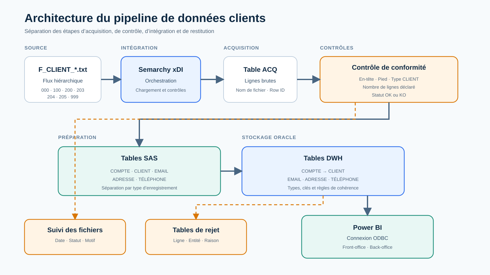

# Dental Customer Data Platform and BI

[Version française](#version-française) · [English version](#english-version)

## Version française

### Présentation

Ce dépôt présente une étude de cas académique réalisée en équipe dans le cadre du Master 2 SIAD de l’Université de Lille en 2024–2025.

Le projet consistait à concevoir une base clients centralisée pour un groupe dentaire régional, depuis l’intégration de fichiers hiérarchiques jusqu’à la restitution dans Power BI. Le périmètre couvrait la modélisation, les contrôles de qualité, la gestion des rejets, la traçabilité des chargements et la création de vues adaptées au front-office et au back-office.

### Ma contribution

J’ai contribué à la conception du modèle de données, à l’analyse des règles métier, à la stratégie de recette, à la coordination du projet et à la restitution Power BI. J’ai également participé à certains travaux techniques d’intégration aux côtés des membres de l’équipe principalement chargés du développement Semarchy.

Le projet étant collectif, ce dépôt décrit la solution et ma contribution sans attribuer à une seule personne l’ensemble des développements.

### Architecture fonctionnelle

```text
Fichier client hiérarchique
            |
            v
Semarchy xDI / Stambia
            |
            v
Zone d’acquisition ACQ
            |
            v
Contrôles de conformité du fichier
       |                         |
       | Conforme                | Non conforme
       v                         v
Tables SAS                  Table de suivi
       |                    et arrêt du flux
       v
Tables Oracle DWH
       |
       +----> Tables de rejet par entité
       |
       v
Power BI via ODBC
```



### Données traitées

Le fichier source utilise le caractère `|` comme séparateur et contient plusieurs types d’enregistrements :

| Code | Entité |
|---|---|
| `000` | En-tête du fichier |
| `100` | Compte client |
| `200` | Client |
| `203` | Adresse email |
| `204` | Adresse postale |
| `205` | Téléphone |
| `999` | Pied du fichier et nombre de lignes |

Le dépôt contient uniquement un [échantillon entièrement synthétique](sample-data/F_CLIENT_SAMPLE.txt). Les données originales ne sont pas publiées.

### Contrôles de qualité

La solution vérifie notamment :

- la présence de l’en-tête et du pied de fichier ;
- le type de fichier attendu ;
- la concordance du nombre de lignes ;
- les champs obligatoires ;
- l’existence du compte associé à chaque client ;
- l’existence du client associé à chaque contact ;
- les codes de cabinet autorisés ;
- la structure minimale des adresses email ;
- la traçabilité du fichier chargé ;
- l’orientation des enregistrements non conformes vers des tables de rejet.

### Restitution Power BI

Cinq vues ont été conçues :

1. recherche et sélection d’un client ;
2. fiche client ;
3. suivi général de la base clients ;
4. suivi de la complétude et de la qualité des contacts ;
5. récapitulatif détaillé exportable.

Les visuels présents dans ce dépôt sont des reconstitutions anonymisées. Ils illustrent l’organisation fonctionnelle sans exposer les données du projet.

### Technologies

- Semarchy xDI, anciennement Stambia
- Oracle Database
- SQL
- Power BI Desktop
- Power Query
- ODBC
- Excel
- fichiers plats délimités

### Contenu du dépôt

```text
docs/         Documentation fonctionnelle et technique en français
assets/       Schémas et maquettes anonymisées
sample-data/  Petit flux synthétique de démonstration
tests/        Matrice de recette publique et nettoyée
```

### Périmètre de publication

Ce dépôt met en valeur la conception, l’architecture, les règles de qualité, la stratégie de recette et la restitution BI. Le code source, les scripts Oracle, le projet Semarchy, le fichier Power BI et les données d’origine restent exclus conformément aux restrictions de diffusion.

Les documents pédagogiques bruts, les identités des autres participants et les informations personnelles présentes dans les données sources sont également exclus.

### Documentation

- [Contexte et objectifs](docs/01-contexte-et-objectifs.md)
- [Architecture data](docs/02-architecture-data.md)
- [Modèle de données](docs/03-modele-de-donnees.md)
- [Intégration et qualité](docs/04-integration-et-qualite.md)
- [Restitution Power BI](docs/05-restitution-power-bi.md)
- [Stratégie de recette](docs/06-strategie-de-recette.md)

---

## English version

### Overview

This repository presents an academic group case study completed during the M2 SIAD program at the University of Lille in 2024–2025.

The project focused on designing a centralized customer data platform for a regional dental group, from hierarchical file ingestion to Power BI reporting. Its scope included data modeling, quality controls, rejected-record management, load traceability, and reporting views for front-office and back-office users.

### My contribution

I contributed to the data-model design, business-rule analysis, test strategy, project coordination, and Power BI reporting. I also supported selected technical integration activities alongside the team members who led the Semarchy development.

As this was a group project, this repository presents the solution and my contribution without attributing the entire implementation to one person.

### Solution architecture

```text
Hierarchical customer file
            |
            v
Semarchy xDI / Stambia
            |
            v
ACQ acquisition layer
            |
            v
File compliance controls
       |                         |
       | Valid                   | Invalid
       v                         v
SAS staging tables          Tracking table
       |                    and process stop
       v
Oracle DWH tables
       |
       +----> Entity-level rejection tables
       |
       v
Power BI through ODBC
```

### Main capabilities

- ingestion of a multi-record pipe-delimited file;
- separation into account, customer, email, address, and phone entities;
- referential-integrity and mandatory-field controls;
- entity-level rejected-record management;
- source-file and processing traceability;
- Oracle-to-Power BI reporting through ODBC;
- five user-oriented reporting views.

### Technology stack

- Semarchy xDI / Stambia
- Oracle Database
- SQL
- Power BI Desktop
- Power Query
- ODBC
- Excel
- delimited flat files

### Publication scope

This public version contains French documentation, redrawn architecture diagrams, anonymized dashboard mockups, a synthetic input sample, and a cleaned test matrix.

The repository highlights the solution design, architecture, data-quality rules, test strategy, and BI reporting. Original source code, Oracle scripts, the Semarchy project, the Power BI file, course materials, and source data remain excluded in accordance with publication restrictions.
