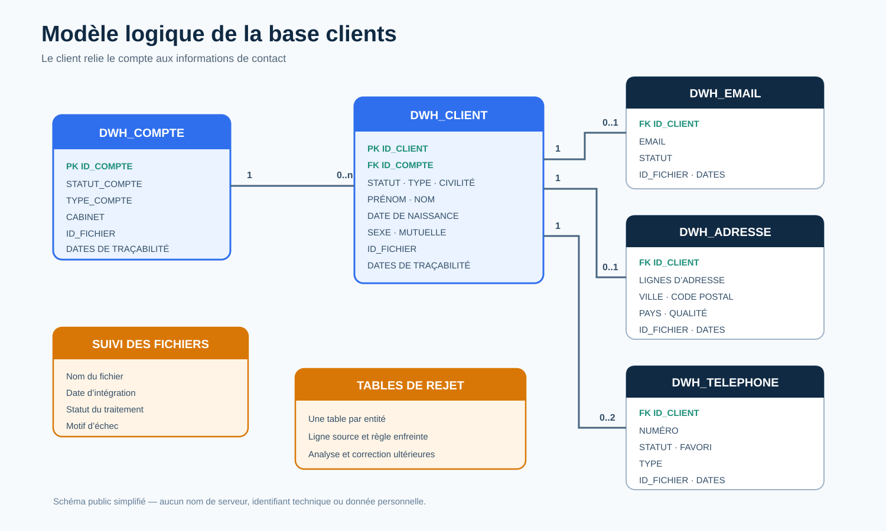

# Modèle de données

## Vue logique

Le modèle place le client au centre des informations de contact. Chaque client est rattaché à un compte, tandis que les emails, adresses et téléphones dépendent du client.

## Entités principales

### Compte

Le compte contient l’identifiant de rattachement, son statut, son type et le cabinet associé.

Un compte peut être associé à plusieurs clients. Un client ne peut pas être intégré si son compte n’existe pas.

### Client

Le client contient notamment son identifiant, son compte, son statut, son type, sa civilité, son nom, son prénom, sa date de naissance, son sexe et sa mutuelle.

### Email

Un client peut posséder zéro ou une adresse email. L’adresse doit être rattachée à un client existant et respecter une validation minimale de structure.

### Adresse

Un client peut posséder zéro ou une adresse postale. L’adresse contient les lignes d’adresse, la ville, le code postal, le pays et un indicateur de qualité.

### Téléphone

Un client peut posséder jusqu’à deux téléphones : un fixe et un portable. Le modèle conserve le statut, le type et l’indicateur de téléphone favori.

## Tables de support

### Suivi

La table de suivi enregistre le nom du fichier, la date d’intégration, le statut du traitement et le motif d’échec éventuel.

### Rejets

Chaque entité dispose d’un espace de rejet permettant de conserver les enregistrements non intégrés et la raison du rejet.

### Transcodification

Les codes techniques sont associés à des libellés fonctionnels pour le type de compte, le type de client, la civilité, le sexe, le pays, le cabinet et le type de téléphone.

## Traçabilité

Chaque table métier permet d’identifier le fichier d’origine. La gestion temporelle distingue la création de l’enregistrement de sa dernière modification afin de préserver la date du premier chargement.
