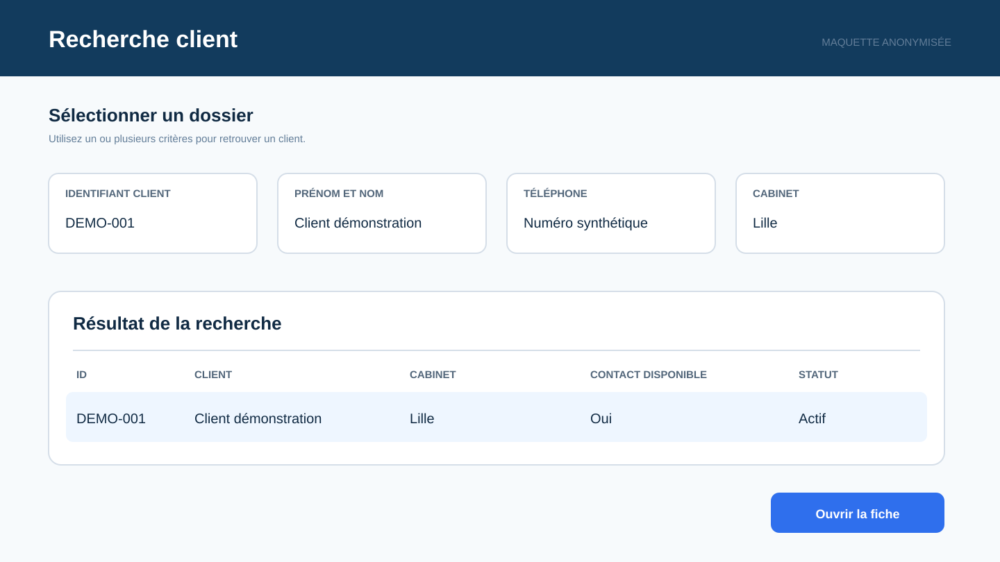
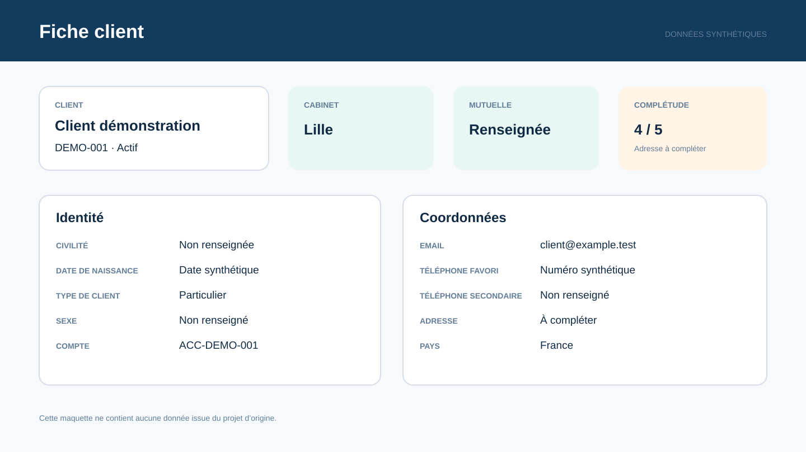
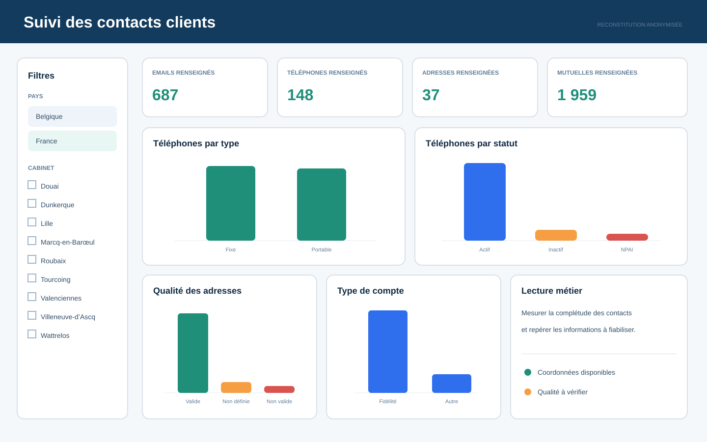
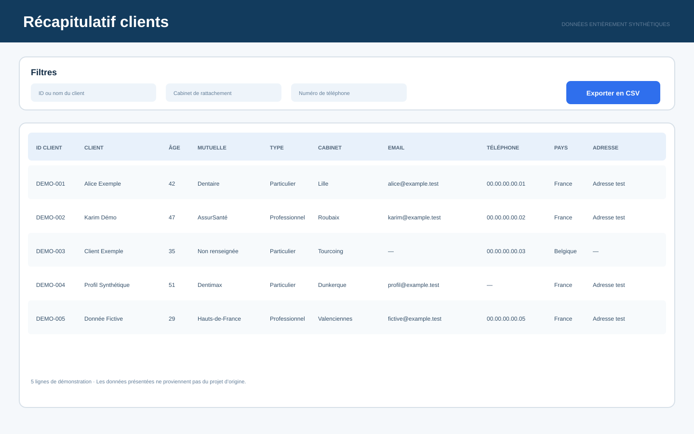

# Restitution Power BI

## Objectifs

La restitution répond à deux usages complémentaires : la consultation opérationnelle par le secrétariat et le suivi global par les fonctions de pilotage.

Power BI récupère les données Oracle au moyen d’une connexion ODBC. Power Query est utilisé pour ajuster certains formats et associer les codes à leurs libellés.

## Vue 1 — Recherche client

La première page permet de sélectionner un client à partir de son identifiant, de son nom, de son téléphone ou de son cabinet de rattachement.

## Vue 2 — Fiche client

La fiche regroupe les informations disponibles pour le client sélectionné : identité, cabinet, mutuelle, email, adresse et téléphones.

## Vue 3 — Suivi des clients

La vue de pilotage présente le nombre de comptes et de téléphones renseignés, l’âge moyen, ainsi que les répartitions par civilité, type de client, mutuelle, pays et cabinet. Des filtres permettent d’affiner l’analyse par pays et cabinet de rattachement.

## Vue 4 — Qualité des contacts

Cette vue suit le nombre d’emails, d’adresses, de téléphones et de mutuelles renseignés. Elle présente aussi la répartition des téléphones par type et statut, la qualité des adresses et le type de compte. Des filtres par pays et cabinet complètent l’analyse.

## Vue 5 — Récapitulatif

La dernière page consolide les informations principales dans un tableau filtrable et exportable : identifiants, identité, âge, mutuelle, type de client, cabinet, email, téléphone, adresse et pays.

## Points de vigilance

Les calculs dérivés, notamment l’âge, doivent être testés avec une date de référence explicite. Les transcodifications doivent également être gouvernées dans une source maîtrisée afin d’éviter des écarts entre la base et la restitution.

Les visuels de ce dépôt sont des maquettes reconstituées. Ils ne constituent pas des captures du système d’origine.
